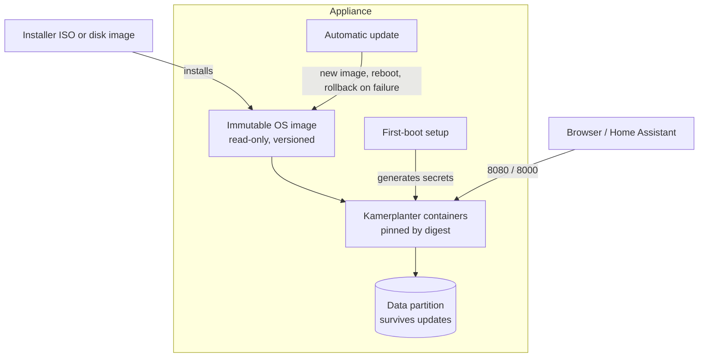

# Kamerplanter Appliance

A bootable appliance for [Kamerplanter](https://github.com/nolte/kamerplanter), the self-hosted plant lifecycle management system.

The appliance is built on an immutable Linux. Its image installs the operating system and brings up all required Kamerplanter containers. Getting started means booting that image, and running it afterwards means not having to look after a Linux distribution.

It is meant for three kinds of places:

- **Hosted servers** at providers such as Hetzner or OVH, with AWS, Azure, and Google Cloud planned to follow
- **Private virtualisation** on Proxmox VE
- **Small private hardware** such as a mini PC of the Intel NUC kind

> **Status: planning.** This repository contains no build yet. This README describes the target the appliance is built towards; sections marked *planned* are not implemented.

## Goals

- **Fast, simple start.** Boot the image, answer as little as possible, open the web UI. Packaging and delivery are the focus of this project.
- **No operating overhead.** The operating system is immutable and updates itself as a whole. The user never runs a package manager, manages operating-system users, hardens the system, or decides which patches to apply.
- **Run it where you want.** The appliance behaves the same on a rented server, a private hypervisor, and a mini PC, so the choice of place stays with the user.
- **Simple updates.** The appliance updates itself and undoes a failed update on its own. The user never has to match operating-system and Kamerplanter versions.
- **Nothing superfluous.** The system contains only what running the containers needs: no graphical system such as X11, no desktop, no development tools, no Kubernetes, no control panel.
- **Package, don't fork.** The appliance ships the published upstream images. Application behaviour is defined in [`nolte/kamerplanter`](https://github.com/nolte/kamerplanter), never here.

## Non-goals

- Developing or building the Kamerplanter services (see the upstream repository).
- A general-purpose server. The appliance runs Kamerplanter and nothing else.
- High availability, clustering, or multi-node operation. For that, use the upstream [Helm chart](https://github.com/nolte/kamerplanter/tree/develop/helm).
- Managed platforms such as Kubernetes services.
- Raspberry Pi and other aarch64 machines, for now. They are deferred until upstream publishes aarch64 images; see [`spec/deployment-targets`](spec/deployment-targets/en.md).

## What is inside

The appliance bundles the core services of a Kamerplanter release:

| Container | Image | Role |
|-----------|-------|------|
| `frontend` | `ghcr.io/nolte/kamerplanter-frontend` | Web UI (nginx), port 8080 |
| `backend` | `ghcr.io/nolte/kamerplanter-backend` | REST API, port 8000 |
| `celery-worker` | `ghcr.io/nolte/kamerplanter-backend` | Background tasks |
| `celery-beat` | `ghcr.io/nolte/kamerplanter-backend` | Periodic task scheduler |
| `arangodb` | `arangodb:3.12` | Primary database |
| `valkey` | `valkey/valkey:9-alpine` | Cache and task broker |

The optional upstream services stay optional, so they cost nothing when unused:

| Option | Adds |
|--------|------|
| `vectordb` | PostgreSQL + pgvector and the reranker for the knowledge assistant |
| `ollama` | Local LLM inference |
| `timescaledb` | Time-series storage for sensor data |

## Architecture (planned)

- **Immutable base:** the system partition is read-only and replaced as a whole. There is no drift between installations, and every appliance of a given version is identical.
- **Containers pinned by digest:** the appliance starts a fixed set of container images. They may be loaded from the registry at the first start; later starts need no registry access.
- **Container control by the distribution:** the service manager of the operating system starts the containers in order, restarts one that fails, and brings everything back after a reboot.
- **First-boot setup:** a one-shot step generates the passwords and salts that upstream requires. No default credentials ship in the image.
- **Separated state:** databases and configuration live on a data partition that updates never touch. Backup covers that partition alone, or the whole VM as a snapshot.
- **Network:** only the web UI (8080) and the API (8000) are reachable from outside. Databases and Valkey stay on loopback, as upstream intends.
- **Protection:** TLS for the web UI and the API, automatic blocking of addresses after repeated failed logins, and a rate limit per source against floods from few sources. All of it is active without configuration.

## Installation (planned)

| Target | Artifact | How |
|--------|----------|-----|
| Proxmox VE | Installer ISO | Attach the ISO to a new VM and let the installer write the disk |
| Mini PC (x86_64) | Installer ISO | Write the ISO to a USB stick and boot from it |
| Hetzner Cloud | Raw disk image | Import the image into your own project, then create servers from the resulting snapshot |
| OVHcloud | Raw disk image | Upload it as a Public Cloud image, or use Bring Your Own Image on a dedicated server |

The artifacts are built by GitHub Actions and published as assets of a GitHub release of this repository. Each one is signed keylessly by the release workflow, so that a download can be checked for authenticity before it is written or booted; see [Verifying a download](docs/en/references/verify.md).

Afterwards the web UI answers on port 8080.

A hosted server has a public address. The appliance is meant to offer TLS there; how it obtains certificates is undecided.

## Updating (planned)

The appliance checks for a new appliance release, downloads it in the background, and activates it with a reboot. If the new version doesn't come up healthy, the system boots the previous one again. The data partition is kept across updates and rollbacks.

There is no separate patching of the distribution. Whether the operating system and the Kamerplanter containers arrive in one update or in two is open; either way the user does nothing.

## Open decisions

- **Immutable base:** which distribution carries the appliance. A documentation review against [`spec/distribution-requirements`](spec/distribution-requirements/en.md) speaks for an image-mode system built from a container image (`bootc` on Fedora or CentOS Stream) over Flatcar Container Linux and openSUSE MicroOS; a prototype has to confirm it.
- **Container runtime:** running the upstream Compose file as-is versus systemd-native container units, depending on what the chosen base supports best.
- **Update policy:** fully automatic with a maintenance window, or announced and confirmed by the user.
- **Update model:** one update for the operating system and the containers together, or the distribution's own update plus containers from a registry.
- **Setup interface:** what the user is asked at first boot (network, hostname, optional services) and where: installer, console, or web page.
- **Delivery to hosted servers:** which tool carries the import on Hetzner Cloud, which OVH products are supported, and in which order AWS, Azure, and Google Cloud are connected. The findings are in [`spec/deployment-targets`](spec/deployment-targets/en.md).
- **Security baseline:** which hardening standard the image is checked against.
- **Database upgrades:** how a rollback behaves once a new Kamerplanter release has migrated the data.
- **TLS:** how the appliance obtains certificates on hosted servers.
- **Minimum sizing:** CPU, memory, and disk requirements for the core stack, to be measured.

## Specifications

- [`spec/deployment-targets`](spec/deployment-targets/en.md) — where the appliance has to be installable and what each place demands
- [`spec/distribution-requirements`](spec/distribution-requirements/en.md) — what the base distribution has to provide
- [`spec/release-distribution`](spec/release-distribution/en.md) — how the artifacts are built in CI, published as release assets, signed, and verified by the user

The audiences these documents serve are listed in [`AUDIENCES.md`](AUDIENCES.md).

## Related repositories

- [`nolte/kamerplanter`](https://github.com/nolte/kamerplanter) — the application, its container images, Compose files, and Helm chart
- [`nolte/kamerplanter-infrastructure`](https://github.com/nolte/kamerplanter-infrastructure) — Terraform modules and scripts that provision the appliance at hosting providers such as Proxmox VE, from server and network to the first-boot configuration
- [Documentation](https://nolte.github.io/kamerplanter/)

All Kamerplanter repositories, including the companions and the ones the appliance needs only indirectly, are described in [Related repositories](docs/en/references/repositories.md).

## License

MIT, see [LICENSE](LICENSE). The packaged container images and the Fedora base keep their own licences.
