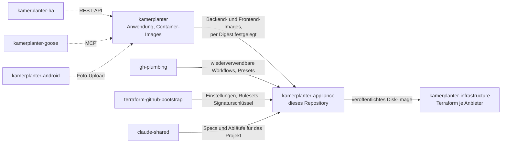

# Zugehörige Repositorys

Kamerplanter verteilt sich auf mehrere Repositorys. Diese Seite führt sie alle auf und sagt, was jedes für die Appliance bedeutet: aus welchen die Appliance gebaut und mit welchen sie ausgerollt wird, welche Begleiter sich mit einem laufenden Kamerplanter verbinden und welche die Appliance nur indirekt braucht, für Bau, Release und die Einrichtung des Repositorys.

Durchgezogene Pfeile zeigen, was die Appliance braucht; gestrichelte Pfeile zeigen Begleiter, die mit einem laufenden Kamerplanter sprechen, auf der Appliance oder anderswo.

## Gebaut aus und ausgerollt mit

| Repository | Was es ist | Rolle für die Appliance |
|------------|------------|-------------------------|
| [`nolte/kamerplanter`](https://github.com/nolte/kamerplanter) | Die Anwendung: Backend, Frontend, Compose-Dateien, Helm-Chart und ihre [Dokumentation](https://nolte.github.io/kamerplanter/) | Veröffentlicht `ghcr.io/nolte/kamerplanter-backend` und `ghcr.io/nolte/kamerplanter-frontend`. Die Appliance liefert diese Images per Digest festgelegt aus; eine neue Kamerplanter-Version kommt daher nur mit einem neuen Appliance-Release auf das Gerät, siehe [Updates und Rollback](../getting-started/updates.md). Das Verhalten der Anwendung wird dort festgelegt, nie hier. |
| [`nolte/kamerplanter-appliance`](https://github.com/nolte/kamerplanter-appliance) | Dieses Repository: das bootfähige System-Image, seine Disk-Images und der Update-Weg | — |
| [`nolte/kamerplanter-infrastructure`](https://github.com/nolte/kamerplanter-infrastructure) | Terraform-Module und Skripte je Hosting-Anbieter, zuerst Proxmox VE | Nimmt das veröffentlichte Appliance-Image unverändert und macht daraus eine laufende Maschine: Server oder VM, Netzwerk, Speicher und die Konfiguration für den ersten Start. Nicht nötig, wenn du die Appliance von Hand installierst. |

## Begleiter

Diese verbinden sich über die API mit einem laufenden Kamerplanter. Sie gehören nicht zum Appliance-Image und werden dort installiert, wo sie hingehören.

| Repository | Was es ist |
|------------|------------|
| [`nolte/kamerplanter-ha`](https://github.com/nolte/kamerplanter-ha) | Custom Integration für Home Assistant: Pflanzenphasen, Nährstoffpläne, Tanks und Pflegeaufgaben als Entitäten, Dienste und Karten in Home Assistant |
| [`nolte/kamerplanter-goose`](https://github.com/nolte/kamerplanter-goose) | Fertige [Goose](https://github.com/block/goose)-Rezepte, die zusammenführen, was Kamerplanter und Home Assistant über eine Pflanze wissen |
| [`nolte/kamerplanter-android`](https://github.com/nolte/kamerplanter-android) | Native Android-App, die Schädlingsfotos mit einem USB-Mikroskop aufnimmt und an Kamerplanter übergibt |

## Indirekt benötigt

Davon läuft nichts auf einer Appliance. Diese Repositorys bestimmen, wie dieses Repository gebaut, veröffentlicht und verwaltet wird.

| Repository | Was es hier beisteuert |
|------------|------------------------|
| [`nolte/gh-plumbing`](https://github.com/nolte/gh-plumbing) | Die wiederverwendbaren GitHub-Actions-Workflows für Release-Entwurf, Veröffentlichung, Dokumentation und Automerge; das gemeinsame Renovate-Preset; und die gemeinsamen Einstellungen der Probot-Apps (`settings`, `release-drafter`, `stale`, `boring-cyborg`), auf denen die Dateien in `.github/` aufbauen |
| [`nolte/terraform-github-bootstrap`](https://github.com/nolte/terraform-github-bootstrap) | Repository-Einstellungen und Branch-Rulesets sowie die Verteilung des gemeinsamen Schlüssels, der System-Images signiert. Appliances prüfen jedes Update gegen dessen öffentlichen Teil. |
| [`nolte/claude-shared`](https://github.com/nolte/claude-shared) | Die gemeinsamen Projekt-Spezifikationen (zum Beispiel zur Release-Automatisierung) und die Claude-Code-Skills und -Agenten, mit denen das Projekt gepflegt wird |
