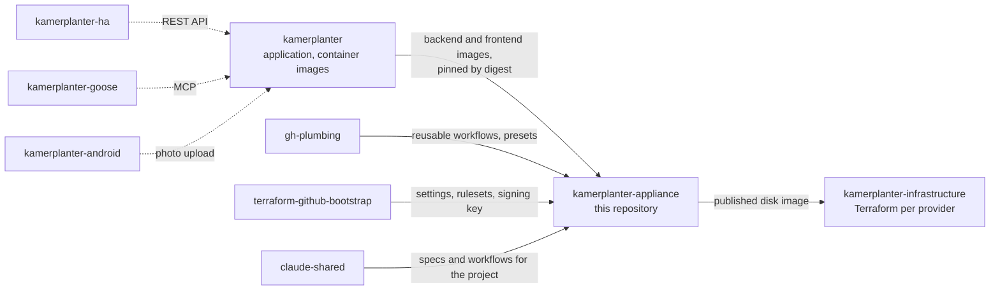

# Related repositories

Kamerplanter is spread over several repositories. This page lists all of them and what each means for the appliance: the ones the appliance is built from or deployed with, the companions that connect to a running Kamerplanter, and the ones that the appliance needs only indirectly, for its build, release, and repository setup.

Solid arrows are what the appliance needs; dotted arrows are companions that talk to a running Kamerplanter, on the appliance or anywhere else.

## Built from and deployed with

| Repository | What it is | Role for the appliance |
|------------|------------|------------------------|
| [`nolte/kamerplanter`](https://github.com/nolte/kamerplanter) | The application: backend, frontend, Compose files, Helm chart, and its [documentation](https://nolte.github.io/kamerplanter/) | Publishes `ghcr.io/nolte/kamerplanter-backend` and `ghcr.io/nolte/kamerplanter-frontend`. The appliance ships these images pinned by digest, so a new Kamerplanter version reaches the appliance only through a new appliance release; see [Updates and rollback](../getting-started/updates.md). Application behaviour is defined there, never here. |
| [`nolte/kamerplanter-appliance`](https://github.com/nolte/kamerplanter-appliance) | This repository: the bootable system image, its disk images, and the update path | — |
| [`nolte/kamerplanter-infrastructure`](https://github.com/nolte/kamerplanter-infrastructure) | Terraform modules and scripts per hosting provider, starting with Proxmox VE | Takes the published appliance image unchanged and brings it up as a machine: server or VM, network, storage, and the first-boot configuration. Not needed when you install the appliance by hand. |

## Companions

These connect to a running Kamerplanter through its API. They are not part of the appliance image and are installed where they belong.

| Repository | What it is |
|------------|------------|
| [`nolte/kamerplanter-ha`](https://github.com/nolte/kamerplanter-ha) | Custom integration for Home Assistant: plant phases, nutrient plans, tanks, and care tasks as Home Assistant entities, services, and cards |
| [`nolte/kamerplanter-goose`](https://github.com/nolte/kamerplanter-goose) | Ready-made [Goose](https://github.com/block/goose) recipes that combine what Kamerplanter and Home Assistant know about a plant |
| [`nolte/kamerplanter-android`](https://github.com/nolte/kamerplanter-android) | Native Android app that captures pest photos with a USB microscope and hands them to Kamerplanter |

## Needed indirectly

Nothing from these runs on an appliance. They shape how this repository is built, released, and administered.

| Repository | What it provides here |
|------------|-----------------------|
| [`nolte/gh-plumbing`](https://github.com/nolte/gh-plumbing) | The reusable GitHub Actions workflows for release drafting, publishing, documentation, and automerge; the shared Renovate preset; and the common settings for the Probot apps (`settings`, `release-drafter`, `stale`, `boring-cyborg`) that the files in `.github/` extend |
| [`nolte/terraform-github-bootstrap`](https://github.com/nolte/terraform-github-bootstrap) | Repository settings and branch rulesets, and the distribution of the shared key that signs system images. Appliances verify every update against that key's public half. |
| [`nolte/claude-shared`](https://github.com/nolte/claude-shared) | The shared project specifications (for example release automation) and the Claude Code skills and agents the project is maintained with |
